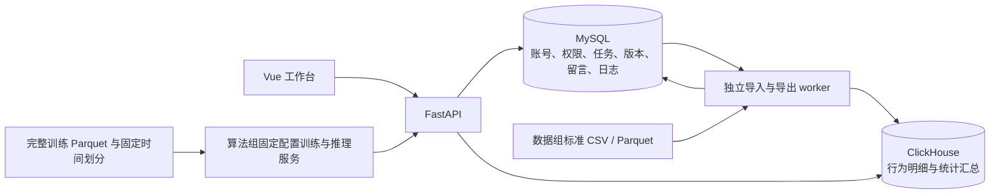
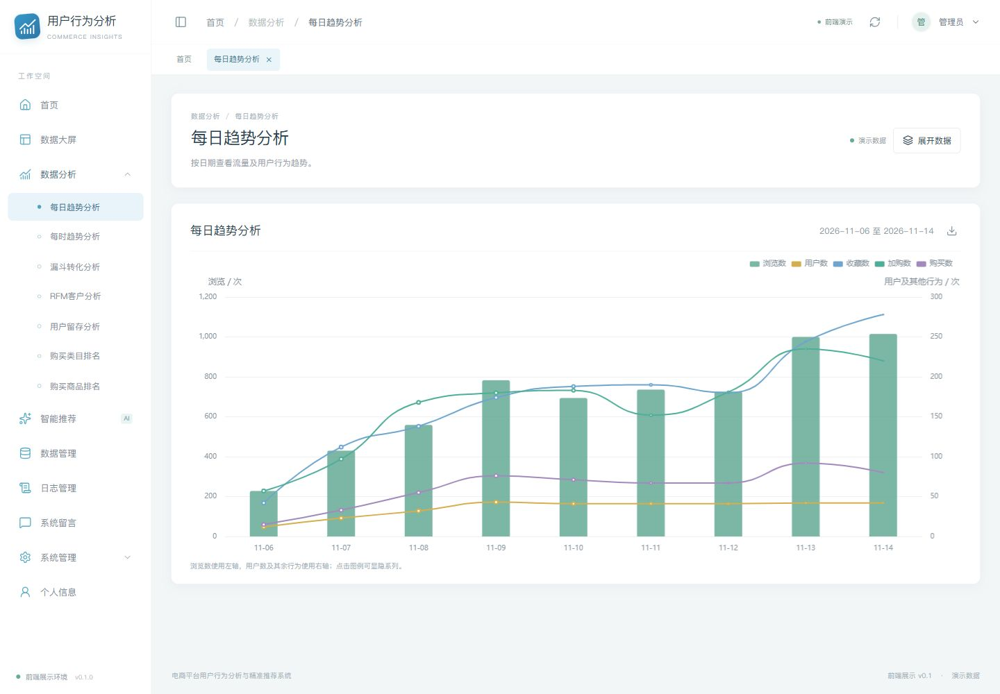

# 电商平台用户行为分析与精准推荐系统

四人课程项目：用户行为分析、用户画像和商品推荐工作台。当前已实现 **Vue 3 前端 + FastAPI 后端 + MySQL 业务库 + ClickHouse 行为分析库**，数据清洗和推荐算法由对应组员继续开发。

## 当前进度

| 部分 | 状态 |
|---|---|
| 登录、账号、角色权限、资料与密码管理 | 已接通数据库和服务端校验 |
| CSV/Parquet 导入、任务、数据版本与导出 | 已实现；支持服务器大文件分批入库 |
| 首页、大屏、趋势、漏斗、RF、留存、排行、画像 | 已接通后端统计与服务端分页 |
| 留言、操作日志 | 已持久化 |
| 模型版本登记与推理服务适配 | 已实现接入协议，等待算法组交付 |
| 数据清洗、真实推荐训练、模型选择 | 由数据和算法负责人实现 |
| 数据清洗与离线分析 | `data_algo/` 已完成 220316 全量清洗、1% 用户抽样、六类离线统计与标准入库导出；真实推荐训练待开始 |

网站操作人员不选择算法或超参数。服务未接入时如实提示状态，不运行假训练或伪造推荐。现有本地联调数据可以使用明确标记的虚构样本，不能把它当作 Kaggle 真实数据或算法效果。

数据模块的离线统计用于核对口径和实验报告；网站统计以大屏/接口的后端实现为准。供网站入库的标准文件只包含 `user_id,item_id,category_id,behavior_type,timestamp` 五列，详见 [数据与算法交付约定](docs/数据与算法交付约定.md)；完整训练文件保留品牌、价格、会话等特征。

## 本地启动

```sh
git clone https://github.com/LiMelson/ecommerce-analytics-recommender.git
cd ecommerce-analytics-recommender
```

准备 Python 3.11、Node.js 24、MySQL 8 和 Docker Desktop。先按 [后端运行说明](backend/README.md) 安装依赖并在本地填写 `backend/.env`；再安装前端依赖：

```sh
cd frontend
npm ci
```

Windows 在仓库根目录运行：

```powershell
./scripts/start-local.ps1
```

- 工作台：<http://127.0.0.1:5173/>
- API 文档：<http://127.0.0.1:8000/api/docs>
- 首次管理员为 `admin`，随机密码保存在本机 `backend/instance/first-admin.txt`。
- 停止本项目 API/worker：`./scripts/stop-local.ps1`，数据库和数据保持保留。

后端、前端分别启动及各平台命令见各自 README。默认只在本机访问，没有自动部署到公网。

## 架构



查询只访问已完成的数据版本。导入失败不替换当前版本，任务与查询分进程运行。模型版本必须与当前数据版本兼容。

## 目录

```text
frontend/          Vue 页面、API 调用、组件与测试
backend/           API、ORM、迁移、导入 worker、测试
infra/             ClickHouse Docker 配置与资源限制
scripts/           Windows 本地启动与停止脚本
recommendation/    算法负责人开发区域与交付说明
data_algo/         数据清洗、DuckDB 抽样、离线统计与网站标准入库导出
data/              数据说明；实际文件不进入 Git
docs/              接口、数据库、协议、调研与验收记录
项目需求文档.docx   早期需求与 Mermaid 架构参考
```

## 团队开发

按 [协作指南](CONTRIBUTING.md) 在独立分支开发，通过 PR 合并。联调以 [接口文档](docs/接口文档.md)、[OpenAPI JSON](docs/openapi.json) 和 [数据与算法交付约定](docs/数据与算法交付约定.md) 为准。

数据集、个人 `.env`、密码文件、依赖、构建产物和本地缓存均不提交。推荐交付分支的四个原发布资产按[资产许可说明](docs/推荐算法-AI接手指南.md#模型资产与版本)核验公开发布条件。数据与训练文件使用各自固定版本，避免通过网页导出全量训练数据。

## 验证与容量

后端提供账号/权限与格式校验测试、隔离 MySQL + ClickHouse 集成测试、可选百万条生成数据负载测试；前端提供纯函数测试、页面 API 接入测试和生产构建。

已进行的检查、实际耗时和容量边界见 [后端验收记录](docs/后端验收记录.md)。**百万级验证不代表已验证亿级全量容量**；真实全量上线前仍要根据字段、用户/商品基数、磁盘与查询范围压测。

## 其他文档

- [数据库设计](docs/数据库设计.md)
- [前端说明](frontend/README.md)
- [后端说明](backend/README.md)
- [推荐算法模块与交接](recommendation/README.md)
- [数据来源说明](data/README.md)
- [数据选型与处理说明](docs/数据选型与处理说明.md)
- [data_algo 模块说明](data_algo/README.md)
- [Kaggle 数据集调研](docs/后端开发清单与Kaggle数据集调研.md)
- [早期文献调研](docs/文献调研与技术路线建议.md)
- [早期需求 Word](项目需求文档.docx)：部分设想已经收敛，当前行为以接口文档及代码为准。

原型界面参考：





