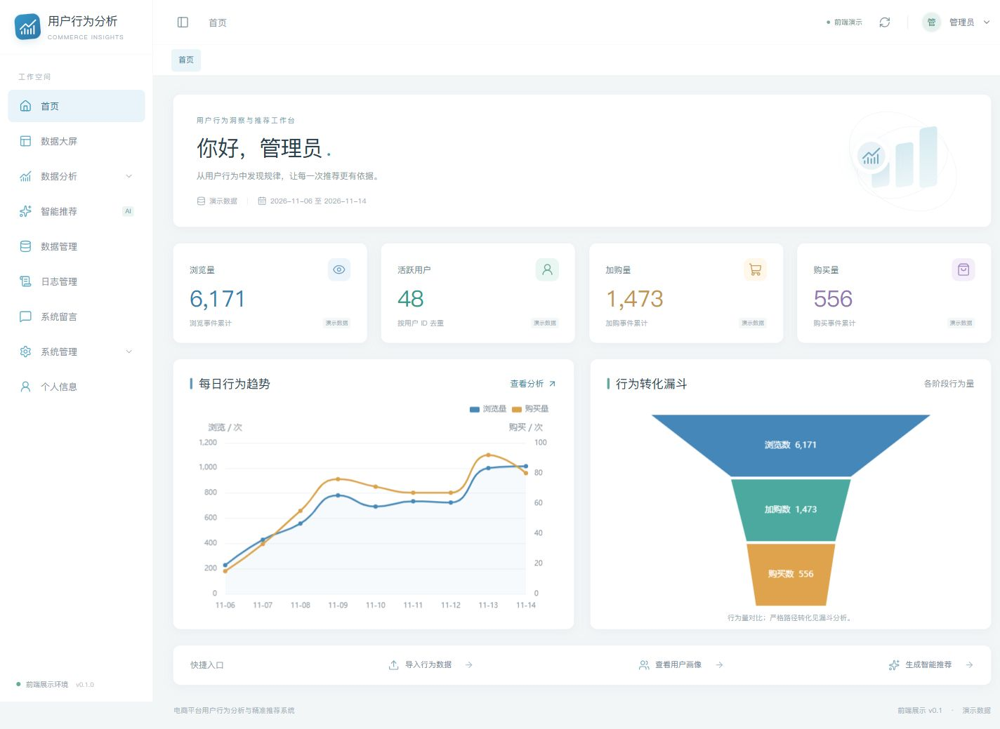
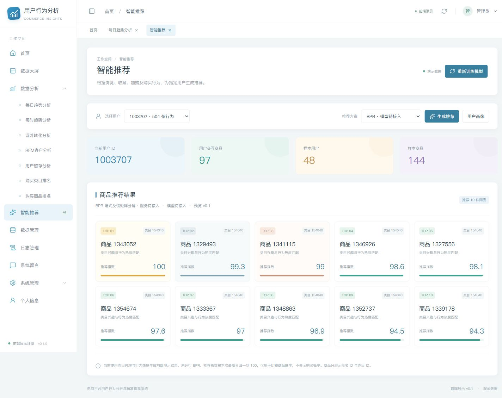

# 电商平台用户行为分析与精准推荐系统

电商用户行为分析、用户画像与个性化商品推荐课程项目。团队规模 4 人，计划开发周期约 1 个月。

**当前已完成可运行的 Vue 前端演示，后端、真实数据处理与推荐模型尚未实现。** 前端默认使用可复现的虚构样本，推荐和训练按钮分别执行前端规则及状态流程演示。

## 本地运行前端

安装 Node.js 24，然后在终端执行：

```sh
git clone https://github.com/LiMelson/ecommerce-analytics-recommender.git
cd ecommerce-analytics-recommender/frontend
npm ci
npm run dev
```

浏览器访问 <http://127.0.0.1:5173/>。若已经克隆项目，直接进入 `frontend/` 运行后两条命令。端口 5173 被占用时，请先关闭之前启动的开发服务器。

验证与构建：

```sh
npm test
npm run build
```

`npm run build` 生成 `frontend/dist/`；构建产物不提交到仓库。详细功能、CSV 限制与数据口径见 [前端说明](frontend/README.md)。

## 界面预览

### 首页



### 每日趋势分析


### 智能推荐



## 目录

```text
ecommerce-analytics-recommender/
├── frontend/             # 已实现的 Vue 3 + Vite + ECharts 前端
├── backend/              # 后端规划说明，尚无服务代码
├── recommendation/       # 推荐算法开发约定，尚无训练代码
├── data/                 # 数据获取说明；实际数据留在本地
├── docs/                 # 文献、后端规划与数据集调研
├── 项目需求文档.docx      # 早期需求与架构文档
├── CONTRIBUTING.md       # 分支、提交、联调与合并流程
└── README.md
```

## 开发范围与当前状态

| 部分 | 当前状态 | 下一步 |
|---|---|---|
| 首页、大屏、趋势、漏斗、RF 分群、留存、排行 | 前端展示与样本计算已完成 | 改为查询后端统计结果 |
| 行为数据管理与用户画像 | 浏览器内演示，刷新恢复样本 | 接入数据清洗、数据库、查询与持久化 |
| 智能推荐 | 前端规则预览 | 建立热门推荐、ItemCF、BPR 实验与模型服务 |
| 训练任务 | 状态流程演示 | 先使用开发者训练脚本，再视需要增加固定配置的管理员任务 |
| 账号、权限、留言与日志 | 前端会话演示 | 核心推荐流程完成后再补齐服务端能力 |

首版以真实行为数据、推荐实验、模型加载与推荐查询为重点。算法和超参数由开发团队固定，网站操作人员选择匿名用户并获取推荐。当前界面仍保留方案选择和参数演示入口，接入后端时需要按此要求调整。

RFM 页面目前只计算 R、F，金额 M 缺失；样本首次出现日期不等于注册日期；购买事件数量不等于订单数。源数据没有收藏、商品名称或图片时，应如实标明缺失。

## 拟采用的后端路线

- API 服务：Python + FastAPI。
- 存储：MySQL 保存查询数据、聚合结果及元数据，CSV/Parquet 保存实验数据文件。
- 训练：独立 Python 脚本，按实验需要使用 PyTorch 等库。
- 推荐：服务启动时加载选定模型及 ID 映射；前端请求推荐时不执行模型训练。
- 接口：计划使用 `/api/v1` 前缀，具体请求、返回结构和错误格式需在联调前确认。

以上为规划，不代表依赖或后端代码已经安装、实现。API 建议与数据集候选见 [后端开发清单与 Kaggle 数据集调研](docs/后端开发清单与Kaggle数据集调研.md)。

## 团队文档

- [团队协作指南](CONTRIBUTING.md)：每人开发自己的分支，通过 Pull Request 合并。
- [前端说明](frontend/README.md)：运行方式、页面功能、数据边界和接入位置。
- [后端开发清单与 Kaggle 数据集调研](docs/后端开发清单与Kaggle数据集调研.md)：当前首版范围、接口方向和候选数据集。
- [文献调研与技术路线建议](docs/文献调研与技术路线建议.md)：早期文献和扩展方案，部分内容超出当前首版范围。
- [项目需求文档（Word）](项目需求文档.docx)：此前整理的需求与 Mermaid 架构图，保留供参考；训练参数选择等旧方案以后续范围约定为准。
- [数据说明](data/README.md)：数据来源和本地目录约定。

## 提交边界

提交源码、依赖锁定文件、测试、配置示例、截图和项目文档。实际数据、模型权重、环境密钥、`node_modules/`、构建产物及本地文档制作缓存已加入忽略规则。各成员在自己的电脑上安装依赖，不需要相互传递 `node_modules` 或整个项目压缩包。
