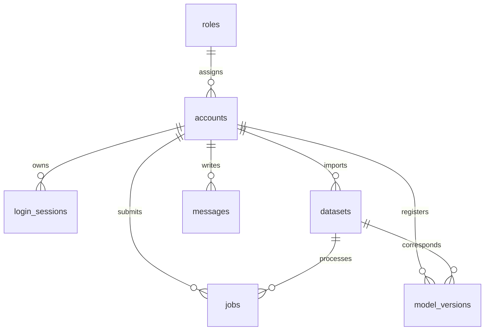
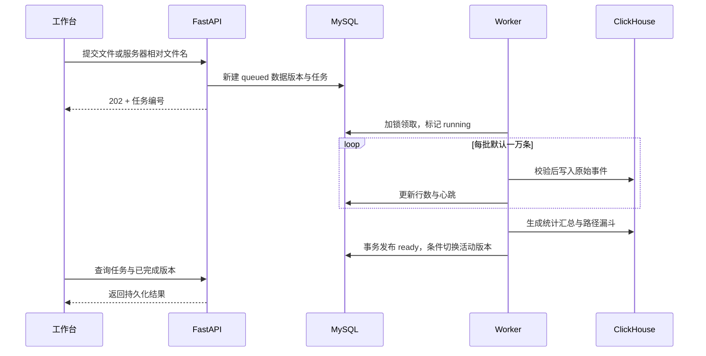

# 数据库设计 · v0.2

MySQL 8 保存业务与控制信息，ClickHouse 保存大规模匿名行为及汇总，完整清洗/训练文件使用 Parquet 保留在本地。所有代码和数据库密码分离，实际数据与模型不进入 Git。

## MySQL

| 表 | 用途 |
|---|---|
| `roles` | 三种固定角色与权限数组 |
| `accounts` | 系统账号、Argon2 密码哈希、角色、启停和资料 |
| `login_sessions` | 随机会话 Token 的 SHA-256、CSRF Token、到期时间 |
| `datasets` | 不可变数据版本、文件摘要、导入状态、范围和统计快照 |
| `jobs` | 持久化导入/导出任务队列、处理进度、心跳与失败原因 |
| `app_settings` | 活动数据集和活动模型 ID |
| `audit_logs` | 服务端操作记录，不记录密码和登录 Token |
| `messages` | 留言、作者及处理状态 |
| `model_versions` | 算法负责人交付的版本元数据及真实评估摘要 |
| `alembic_version` | MySQL 迁移版本，由 Alembic 管理 |

行为数据中的匿名用户不在 accounts 中创建账号，不将上亿条行为写入 MySQL。数据库默认使用 utf8mb4_bin，避免 ID 的大小写被不小心合并。所有业务时间戳保存为 Unix 秒，行为事件为毫秒。

MySQL 初始迁移见 `backend/migrations/versions/831430356b05_initial_business_schema.py`；[参考 SQL](schema-mysql.sql) 供查看结构，实际建库与升级统一使用 `python -m app.cli init`。

## ClickHouse

| 表 | 内容与访问方式 |
|---|---|
| `behavior_events` | 原样记录已校验的事件，按事件月份分区；排序键为 dataset_id、北京时间日期、user_id、毫秒时间、版本内序号 |
| `daily_stats` | 每日各类事件数与精确日去重用户数 |
| `hourly_stats` | 北京时间 24 小时行为汇总 |
| `user_stats` | 用户总行为、去重商品、各类行为、最近时间、首次日期与活跃日期集合 |
| `purchase_rankings` | 购买类目/商品的事件数与购买用户数 |

使用 MergeTree，原始表为 item_id 增加 Bloom Filter 跳数索引。汇总在整个版本导入完成后构建，页面读取不可变汇总，不在每次请求中重新执行全量分群和漏斗。准确去重使用 uniqExact，未把近似人数当作精确值。

初始 DDL 由 `app/analytics.py` 维护，[参考 SQL](schema-clickhouse.sql) 可供查看。已有表结构变更需单独版本迁移。行为记录不在网页逐行修改或删除，修正数据应重新清洗并导入新版本。

## 跨库发布

MySQL 和 ClickHouse 不共用事务。未完成或失败的数据版本永远不能由查询接口选中；任务失败保留旧活动版本。任务领取使用 FOR UPDATE SKIP LOCKED；失去运行状态的 worker 不允许晚到发布，避免管理员结束任务后旧进程又恢复发布。

任务重提创建新的数据 ID，不复用部分写入版本。记录源文件 SHA-256 与入队时的大小/修改时间，导入期间源文件应保持不变。失败物理数据、上传原件和导出文件尚未自动清理，应在确认无任务引用后制定保留策略；当前不自动删除用户的数据。

## 单机资源与扩展

本地 ClickHouse 容器限制 3 GiB、2 CPU；查询默认最多 30 秒、2 线程、约 1.2 GB，并设置聚合/排序溢写磁盘阈值。限制避免单个查询无限占用开发机器，但不保证所有亿级查询能在该限制内完成。

原始文件不一次读入内存，CSV 逐行、Parquet 按批处理。无用户/商品过滤的行为条数使用日汇总，避免为了显示分页总数扫描全表。复杂完整分组仍依赖实际用户、商品基数与磁盘吞吐；逐步增量压测后再调整批量、索引、预计算与资源。

首版没有分布式集群、自动重平衡、跨库强事务或生产备份平台。正式使用前需补备份演练、清理与容量监控，不能仅依据行数认定机器一定承载得住。
